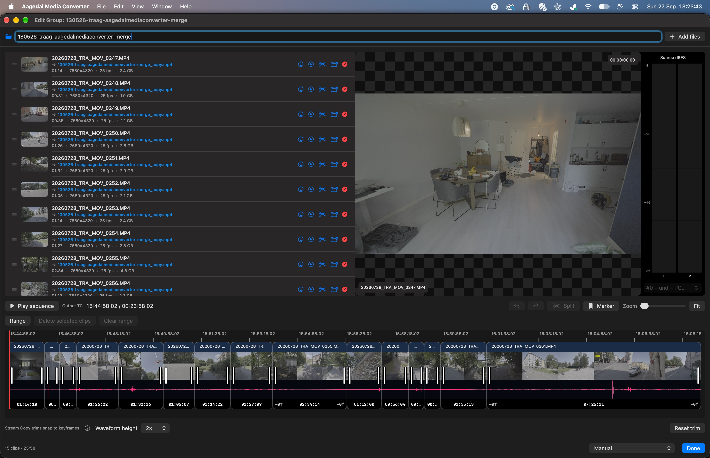

# Aagedal Media Converter

[English](../../README.md) · [Norsk bokmål](README.nb.md) · [Español](README.es.md) · [简体中文](README.zh-CN.md) · [Français](README.fr.md) · [Italiano](README.it.md) · [Deutsch](README.de.md) · [日本語](README.ja.md) · [Português (Brasil)](README.pt-BR.md) · [한국어](README.ko.md)


가볍고 미니멀한 macOS 앱입니다. 겉보기에는 단순하지만 강력한 기능을 다양하게 갖추고 있습니다. FFmpeg, MPV, SwiftMediaMetadata, yt-dlp, rclone, whisper.cpp를 활용하며, 전체가 Swift / SwiftUI로 작성되었습니다.

완전히 무료이며 오픈 소스입니다. 개인정보를 보호하고 로컬에서 처리합니다. 선택 사항인 업데이트 확인은 기본적으로 활성화되어 있지만 끌 수 있습니다.

업무 효율을 높이기 위해 직접 만든 개인 프로젝트로, 다른 사람들과도 공유하고 싶어 공개했습니다. 앱의 대부분은 AI의 도움을 받는 ‘바이브 코딩’ 방식으로 개발되었습니다.

---

## 설치

### Homebrew
```bash
brew tap aagedal/tap && brew install --cask aagedal-media-converter
```

### 직접 다운로드
[현재 릴리스 다운로드](https://github.com/aagedal/Aagedal-Media-Converter/releases/latest)

---

## 주요 기능

- **빠른 실행과 간편한 사용**
- 거의 모든 동영상 및 오디오 파일의 **일괄 변환** (Shutter Encoder 또는 Handbrake 대안)
- 타임코드 표시와 JKL 제어를 지원하는 **전체 화면 재생** (IINA 또는 VLC 대안)
- C2PA 정보 유무 확인을 포함한 **메타데이터 조회 및 비교** (MediaInfo 대안)
- 라우드니스, 무음, 피크, 스테레오 위상 및 인코딩된 영상 품질 **분석**
- 예약 및 실시간 방송 저장을 지원하는 웹 동영상 **다운로드**
- 시스템 오디오와 선택 사항인 별도 마이크 트랙을 포함한 **화면 녹화** (OBS 대안)
- 동영상과 오디오를 **텍스트로 변환**하여 SRT 자막 생성
- 변환 후 서버로 **업로드**
- 시퀀스 미리보기와 리플 트리밍을 지원하는 타임라인에서 클립 **이어 붙이기**
- 선택적으로 활성화하는 에이전트 접근을 통해 **로컬 MCP로 변환 자동화**

### 일반 기능

- 거의 모든 동영상 파일의 미리보기 및 인코딩
- 오디오 연결과 프레임 레이트 설정을 지원하는 **이미지 시퀀스** 가져오기 및 내보내기 (PNG, TIFF, EXR, DPX, JPEG 2000 등)
- JPEG 2000 XYZ 영상과 PCM 오디오를 포함한 **DCP (Digital Cinema Package)** 내보내기
- 전달 도구에서 검증할 수 있는 실험적 **IMF App 2e 및 RDD 45** 패키지 내보내기
- 일괄 변환, 감시 폴더, 진행률 표시
- 길이 다듬기, 화면 자르기, 오디오 트랙 재배치 또는 제거, 같은 형식의 클립 병합
- 메타데이터 조회 및 비교
- 다양한 [키보드 단축키](../../KeyboardShortcuts.md): 대부분의 기능을 마우스 없이 사용 가능
- 다양한 사용자 설정
- 눈에 잘 띄지 않는 알림으로 업데이트 자동 확인, 비활성화 가능
- YouTube, TikTok 등에서 다운로드 (yt-dlp)
- SRT 자막으로 음성 전사 (whisper.cpp)
- FTP 업로드 (rclone)
- C2PA 서명 확인 (SwiftMediaMetadata)
- 시스템 오디오와 선택 사항인 별도 마이크 트랙을 포함한 HDR 화면 녹화

### 일괄 변환

- 대기열의 모든 파일을 자동으로 인코딩
- 파일을 드래그하여 인코딩 순서 변경
- 인코딩 중에도 대기열에서 파일 제거 가능

### 감시 폴더

- 지정한 폴더에서 파일 자동 가져오기
- 수동 드래그 앤 드롭 가져오기와 함께 사용하며, 모든 변환 작업을 하나의 창에 모음
- 감시 폴더 파일의 자동 삭제 및 제외 옵션
- 기본 창 도구 막대의 눈 모양 아이콘으로 활성화

### 미리보기

- JKL 및 방향키 등 일반적인 편집 단축키
- 간단한 오디오 레벨 미터 (⌘A)
- 호환되는 파일에는 macOS 기본 플레이어를 사용하여 역방향에서도 부드럽게 재생
- macOS가 기본 지원하지 않는 파일은 MPVKit으로 자동 전환. 단, 역방향 재생의 안정성은 낮음

### 빠른 조정

- 핸들이나 I/O 키로 길이 다듬기
- 원본 타임코드 복사, 직접 설정 또는 제거
- 화면 위의 컨트롤로 영상 자르기. 트리밍 화면에서 C 키 또는 자르기 아이콘 사용
    - Stream Copy 프리셋에서는 사용 불가
- 오디오 트랙 삭제 및 순서 변경
    - Stream Copy 프리셋에서는 사용 불가

### 세부 조정

대기열의 파일을 오른쪽 클릭하고 **Adjustments…**를 선택하면 파일별로 다음을 설정할 수 있습니다.

- **회전** (90°/180°) 및 가로/세로 **뒤집기** (화면 자르기 이후, 프리셋 크기 조정 전에 적용)
- 음높이가 유지되는 오디오와 함께 **0.25×~4× 속도 조절**
- 영상의 검은 화면 페이드 인/아웃 및 오디오 페이드 인/아웃
- 싱크가 어긋난 클립을 보정하는 **오디오 오프셋** (양수는 오디오를 지연시킴)
- 다른 파일에서 **오디오 교체 또는 추가** (트리밍에 맞춰 정렬하고 영상 길이에 맞춤)
- 텍스트 자막 트랙이나 SRT, ASS, VTT 파일의 **자막 번인** (글꼴 크기, 외곽선 또는 배경 상자, 위치 지정 가능). 이미지 자막 (PGS, DVD)은 먼저 SRT로 자막 OCR이 필요합니다.
- 파일별 라우드니스 정규화 재정의

세부 조정은 재인코딩 프리셋이 필요하며, Stream Copy, DCP, IMF, AV2, 병합 또는 파형 애니메이션 영상에서는 사용할 수 없습니다.

### 라우드니스 정규화

**Settings → Presets**에서 **Normalize Loudness**를 켜면 재인코딩되는 모든 오디오 트랙을 EBU R128 (−23 LUFS, −1 dBTP), ATSC A/85, 스트리밍 (−14 LUFS), 웹/팟캐스트 (−16 LUFS) 또는 사용자 지정 목표치로 정규화합니다. 각 트랙은 첫 번째 패스에서 측정한 뒤, 프로그램이 허용하는 범위에서 선형 게인을 적용하는 FFmpeg의 `loudnorm`으로 정규화됩니다. AVC-Intra와 같은 모노 트랙 방송 프리셋은 분할하기 전에 원본 트랙별로 측정하므로 스테레오 밸런스가 유지됩니다.

### 대기열 파일 병합

- 코덱, 해상도, 프레임 레이트, 비트 심도 및 오디오 트랙이 같은 파일 병합
- 대기열의 첫 번째 클립이 타임코드와 화면 자르기의 기준
- 필름스트립, 시퀀스 재생, 리플 트리밍, 순서 변경, 분할, 구간 삭제 및 실행 취소를 지원하는 타임라인에서 그룹 편집
- Stream Copy로 재인코딩 없이 다듬고 병합. 절단 위치는 원본 키프레임에 따라 달라지므로 선택한 경계와 다를 수 있으며, 일부 메타데이터가 손실될 수 있음
- Resolve EDL 클립 마커와 내장 챕터 내보내기. 기존 챕터는 유지 또는 교체 가능

### 카메라 카드에서 가져오기

- 가져오기 전에 카드 폴더와 촬영 날짜별로 클립 검토
- 연속 녹화의 후속 클립을 명시적으로 표시하고, 선택적으로 두 시간을 초과하는 간격에서 그룹 분리. 호환성 검사로 이어 붙일 수 있는 클립 확인

### 로컬 에이전트 접근

**Settings → Agent Access**를 활성화하고 원본 폴더를 승인한 다음 MCP 클라이언트용 설정을 복사하세요. 포함된 도우미를 통해 에이전트는 승인된 미디어를 탐색하고 검사하며, 변환을 계획하고, 작업을 제출하고, 진행 상황을 확인하고, 앱 대기열의 작업을 취소할 수 있습니다. 21개의 기본 프리셋 (Lossless FFV1을 제외한 모든 기본 프리셋)을 사용할 수 있으며, 사용자 지정 FFmpeg 슬롯은 제외됩니다. IMF 내보내기는 실험적 기능입니다.

수락된 작업은 클라이언트 연결이 끊겨도 계속됩니다. 계획은 15분간 유효하고, 종료된 작업의 결과는 30일간 유지됩니다. 에이전트를 통한 내보내기에서는 출력 타임코드가 비활성화됩니다. 폴더 승인, 클라이언트 설정 및 작업 복구는 [설정 및 작업 흐름 가이드](../../Documentation/LOCAL_AGENT_ACCESS.md)를 참조하세요.

### 오디오 파형 애니메이션

- 오디오 전용 파일에서 파형 애니메이션 생성
- 7가지 네이티브 Swift 스타일 (Halo, Orb, Ridgeline, LED Meter 등)과 5가지 클래식 FFmpeg 스타일, 그리고 그라데이션 팔레트, 색상, 불투명도, 투명 배경 및 정규화 옵션 지원

### 원본 해상도와 비트 심도로 정지 이미지 캡처

트리밍 플레이어의 카메라 버튼으로 원본 해상도의 정지 이미지를 캡처할 수 있습니다. 기본 형식은 JPEG XL입니다. 설정에서 비트 심도별 이미지 형식과 알파 채널이 있는 영상의 처리 방식을 지정할 수 있습니다.

### 내보내기 및 파일 이름

- 기본적으로 공백과 특수 문자를 제거하며, æ, ø, å는 ae, o, aa로 대체
- 처리된 파일 이름 미리보기
- 파일이 이미 존재하면 경고 표시
- 인코딩 후 아이콘으로 내보내기 폴더의 변환된 파일 표시
- 다른 아이콘으로 결과 파일을 다른 앱이나 폴더에 드래그 가능
- 설정에서 기본 프리셋 지정
- 기본 내보내기 위치 지정

### 메타데이터

- 파일별 선택적 댓글 필드로 크레딧 등의 정보 추가
- 댓글 앞에 선택적 날짜 태그 (Generated [YYYYMMDD]), 접두사 및 접미사 추가
- 메타데이터 조회 및 비교

### 미디어 분석


대기열 파일의 차트 버튼을 열어 오디오 및 비디오 보고서를 확인할 수 있습니다.

- 개별 트랙, 사용자 지정 모노 페어 또는 5.1 모노 그룹의 전체 프로그램 라우드니스와 트루 피크를 측정하고 전체 JSON 또는 PDF 보고서로 내보내기.
- 무음 및 피크 구간을 찾고, 채널 밸런스를 비교하거나 스테레오 상관관계와 모노 폴드다운을 확인. 일시 정지된 미리보기에서 측정된 구간으로 이동하고 전체 JSON 측정치를 내보내기.
- 원본 영상에서 블랙 구간 (FFmpeg `blackdetect`, 최소 지속 시간·화면 비율·픽셀 임곗값 조정 가능)과 장면 전환 (FFmpeg `scdet`, 임곗값 조정 가능 및 컷별 썸네일 제공) 감지. 이벤트를 클릭해 일시 정지된 미리보기에서 확인한 뒤 JSON 또는 Resolve EDL 마커로 내보내기. 자세한 내용은 [블랙 구간](../../docs/video-black-report-format.md) 및 [장면 전환](../../docs/video-scene-cut-report-format.md) 보고서 형식을 참조하세요.
- 인코딩 후 VMAF, PSNR, XPSNR 또는 샘플링된 SSIMULACRA2로 영상 비교. 시간대별 품질을 살펴보고, 원본/출력 재생을 전환하며, 점수가 가장 낮은 구간으로 이동.
- SSIMULACRA2는 짧은 클립을 포함해 선택한 한도까지 검증된 디코딩 프레임을 비교합니다. 영상을 먼저 인덱싱하므로 샘플 수가 많을수록 시간이 더 걸립니다.
- 타임라인, 구성 요소 점수 및 비교 경고가 포함된 전체 해상도 JSON 또는 페이지가 나뉜 A4 PDF로 영상 품질 보고서 내보내기. 자세한 내용은 [점수 해석 및 보고서 세부 사항](../../docs/video-quality-report-format.md)을 참조하세요.

### VideoLoop의 15초 자동 재생 경고

브라우저는 소리가 있는 긴 반복 동영상의 자동 재생을 차단하는 경우가 많습니다. 15초를 초과하는 클립에 VideoLoop 프리셋을 적용하면 노란색 ⚠️ 아이콘이 표시되어 클립을 다듬거나 다른 프리셋을 선택하도록 안내합니다.

### App Intents

1. 인코딩 대기열에 추가.
2. 기본 프리셋으로 동영상 즉시 변환.

---

## 내보내기 프리셋

모든 프리셋을 시작 시 기본값으로 설정할 수 있습니다. 기본 프리셋을 제외한 나머지는 선택 메뉴에서 숨길 수 있습니다.

#### Video Loop

소리 없는 자연스러운 반복 재생에 최적화되어 있습니다. x264, CRF 23 (가변 비트레이트 약 3–9 Mbps)으로 인코딩하고 오디오를 제거하며, 웹 재생을 위해 짧은 변을 1080픽셀로 제한합니다. 클립이 15초를 초과하면 경고가 표시됩니다.

#### Video Loop w/ Audio

같은 x264 설정을 사용하지만 모든 오디오 트랙을 128 kbps AAC로 유지합니다. 짧은 변은 여전히 1080픽셀로 제한됩니다.

#### H.264 / AVC

호환성이 높은 H.264/AVC 인코딩입니다. 빠른 VideoToolbox 하드웨어 인코딩 또는 CRF 제어를 지원하는 품질 중심의 libx264 소프트웨어 인코딩을 선택할 수 있습니다. MP4, MOV 및 MKV 컨테이너를 지원합니다.

#### H.265 / HEVC

10비트 H.265/HEVC 인코딩입니다. VideoToolbox로 빠르게 하드웨어 인코딩하거나 압축 효율을 위해 libx265 소프트웨어 인코딩을 선택할 수 있습니다.

#### AV1

10비트 지원과 높은 압축 효율을 제공하는 SVT-AV1 인코딩입니다. 소프트웨어 인코딩만 지원하며, macOS 하드웨어 가속은 지원하지 않습니다.

#### AV2 (실험적)

포함된 AOM AVM 참조 인코더 (`avmenc`)를 사용하는 실험적 AV2 인코딩으로, 프리뷰 버전에서 도입되었습니다. 8/10비트 출력, 고정 품질 또는 가변 비트레이트, 속도 및 해상도 설정을 지원합니다. 고정 품질 모드에서는 분할한 구간을 여러 CPU 코어에서 병렬로 인코딩할 수 있습니다.

포함된 인코더와 디코더는 AVM `1.0.0-445-g14342caad` (2026년 10월 14일)을 사용합니다. 이 도구는 여전히 실험적 단계입니다. 고정된 소스, 다시 빌드하는 방법 및 확인 사항은 [빌드 및 호환성 검증](../../docs/av2-integrated-encoder-2026-10-14.md)을 참조하세요.

영상 전용 IVF (`.ivf`) 또는 AAC / Opus 오디오가 포함된 Matroska (`.mkv`)를 선택할 수 있습니다. 참조 인코딩은 매우 느리며, 재생하려면 AV2 호환 디코더가 필요합니다. 앱은 변환과 썸네일 생성을 위해 AV2를 디코딩할 수 있지만, 대화형 재생은 아직 지원하지 않습니다. AV2는 납품 형식보다는 실험용으로 사용하세요.

#### VP9 / WebM

웹용 로열티 프리 VP9 인코딩으로, libvpx를 사용해 고정 품질 (목표 비트레이트 0의 CRF) 및 행 기반 멀티스레딩으로 인코딩합니다. CRF, Best에서 Realtime까지의 속도, 8비트 (프로파일 0) 또는 10비트 (프로파일 2), 해상도 제한을 선택할 수 있습니다. 오디오는 비트레이트를 선택할 수 있는 Opus로 인코딩합니다. WebM 또는 Matroska (`.mkv`)로 출력합니다. Opus는 `5.1(side)` 같은 일부 채널 레이아웃을 인코딩할 수 없으므로 오디오 라우팅으로 해당 트랙을 다운믹스하세요.

#### TV (HEVC 10-bit 4:2:2)

하드웨어 HEVC 10비트 4:2:2를 사용하는 방송 납품 형식입니다. 해상도와 프레임 레이트 설정, 자동 비트레이트 조정을 지원하며, 모든 오디오 채널을 24비트 PCM으로 유지합니다.

#### TV (AVC-Intra)

MXF 컨테이너를 사용하는 방송 형식입니다. AVC-Intra 10비트 4:2:2의 클래스 (50/100/200 Mbps), 해상도 및 프레임 레이트를 선택할 수 있으며, 4/8/16개의 24비트 PCM 모노 오디오 채널을 제공합니다.

#### XDCAM HD422 (MXF)

Sony XDCAM HD422 방송 납품 형식입니다. MXF OP1a 파일에 MPEG-2 4:2:2 Profile @ High Level, 50 Mbps CBR 롱 GOP (25/50 Hz에서 12프레임, 29.97/59.94 Hz에서 15프레임의 닫힌 GOP, B프레임 2개)로 인코딩합니다. 1080i50, 1080p25, 1080i59.94, 1080p29.97, 720p50 또는 720p59.94를 선택할 수 있습니다. 원본은 풀 래스터 16:9로 크기 조정되며 필요에 따라 필러박스 또는 레터박스가 적용되고, 오디오는 4개 또는 8개의 모노 24비트 48 kHz PCM 트랙으로 출력됩니다.

#### Stream copy

기존 오디오 및 영상 스트림을 새 파일로 복사하여 원본 코덱, 메타데이터 및 확장자를 유지합니다. 길이 다듬기와 병합에 적합합니다.

#### ProRes

편집하기 쉬운 마스터 파일을 위한 Apple ProRes (yuv422p10)입니다. 첫 번째 영상 및 오디오 스트림을 포함하고, 24비트 PCM 오디오를 유지하며, 표준 ProRes 비트레이트를 사용합니다. 기본 프로파일은 프리셋 설정에서 선택할 수 있습니다.

#### DNxHR

편집과 마스터링을 위해 원본 해상도로 출력하는 Avid DNxHR입니다. LB, SQ, HQ (8비트 4:2:2), HQX (10비트 4:2:2) 또는 444 (10비트 4:4:4)를 선택할 수 있으며, MOV 또는 MXF 컨테이너를 지원합니다. 모든 오디오 트랙은 24비트 PCM으로 유지됩니다 (MXF에서는 48 kHz로 리샘플링).

#### CineForm

편집 및 피니싱을 위해 원본 해상도로 MOV 컨테이너에 출력하는 GoPro CineForm입니다. 10비트 4:2:2 YUV, 12비트 4:4:4 RGB 또는 알파 채널 포함 12비트 4:4:4 RGB를 지원하며, Low부터 Film Scan 3+까지 품질을 선택할 수 있습니다 (기본값 Film Scan 1). 코덱은 채널당 최대 12비트만 저장하므로 16비트 원본은 12비트로 축소됩니다. FFmpeg 인코더는 가로 길이가 16의 배수여야 하므로 그렇지 않은 너비는 양옆에 검은 여백이 추가됩니다. 모든 오디오 트랙은 24비트 PCM으로 유지됩니다.

#### Proxy

해상도 제한을 설정할 수 있는 HEVC, ProRes Proxy 또는 DNxHR 프록시를 생성합니다. 모든 오디오 채널을 비압축 PCM으로 유지하며, 오프라인 편집과 원본 자료 옆의 전용 Proxy 하위 폴더에 적합합니다.

#### DCP (Digital Cinema Package)

SMPTE 표준을 준수하는 DCP 내보내기입니다. BT.709 입력을 12비트 XYZ 색 공간으로 변환하여 JPEG 2000으로 인코딩하고, asdcp-wrap으로 MXF에 담으며, 필요한 SMPTE XML (CPL, PKL, ASSETMAP, VOLINDEX)을 생성합니다. 2K 및 4K의 Flat, Scope, Full 형식과 24/25/30/48 fps를 지원하고, 비트레이트는 100–250 Mbps로 설정할 수 있습니다. 오디오는 별도 MXF 트랙에 24비트 PCM으로 내보냅니다. 항목별 메타데이터에는 제목, 콘텐츠 유형, 주석, 등급 및 오디오 언어가 포함됩니다. 크기 조정은 전체 맞춤 (검은 여백 추가) 또는 화면 채우기 (자르기)를 선택할 수 있습니다.

#### IMF App 2e / RDD 45 (실험적)

영상 트랙 하나와 PCM 오디오 트랙 하나를 포함하는 실험적 IMF 패키지 내보내기입니다. 패키지 내 자막과 여러 오디오 트랙은 지원하지 않습니다. 납품 전에 대상 마스터링 또는 전달 도구에서 각 패키지를 검증하세요.

#### Image Sequence

PNG, JPEG, TIFF, EXR, DPX, BMP, TGA, SGI, JPEG XL 및 JPEG 2000 이미지 시퀀스를 가져오고 내보냅니다. 프레임 번호를 자동 감지하며 누락된 번호도 허용합니다. 재생과 내보내기를 위해 오디오 파일을 연결할 수 있습니다. 프레임 레이트는 시퀀스별로 설정하거나 연결된 오디오 길이에서 자동 계산할 수 있습니다. 색 공간, 코덱 및 카메라 정보가 포함된 별도 메타데이터 파일 (Markdown 또는 JSON)도 선택적으로 내보낼 수 있습니다.

#### Animated Stills

GIF, AVIF, 애니메이션 PNG (APNG), 애니메이션 WebP 또는 애니메이션 JPEG XL 이미지 시퀀스입니다. 프리셋 설정 메뉴에서 선택할 수 있습니다.

#### Lossless (FFV1)

비압축 PCM 오디오를 포함한 Matroska (`.mkv`) 형식의 수학적 무손실 FFV1 아카이브 인코딩입니다.

#### Audio Only

오디오를 WAV (모든 채널을 유지하는 비압축 PCM), FLAC, ALAC 또는 AAC/MP4로 추출하거나 변환하며, 프리셋 설정에서 구성할 수 있습니다.

#### 사용자 지정 FFmpeg 프리셋 10개

10개 프리셋 (C1–C10)에서 출력 인수, 접미사 및 확장자를 지정할 수 있습니다. 입력 매개변수는 자동 처리됩니다. `-copy`를 사용하는 경로는 프리셋 설정의 화면 자르기 또는 오디오 재배치 옵션과 함께 사용할 수 없습니다.

#### [할 일 / 알려진 문제](../../TODO.md)

---

## 스크린샷

#### 그룹 타임라인 보기

클립 목록 옆에서 시퀀스를 미리 보고 썸네일, 오디오 파형, 트리밍 핸들 및 출력 타임코드를 확인할 수 있습니다. 타임라인은 분할, 마커, 구간 선택 및 확대/축소 제어도 제공합니다.



#### 트리밍 보기


#### 화면 자르기 보기


#### 오디오 재배치


#### 다운로드 보기


#### 메타데이터 보기


#### 타임코드 덮어쓰기


#### 설정 보기


#### 전체 화면 플레이어


---

## 시스템 요구 사항

| | 최소 요구 사항 |
|---|---|
| macOS | 15.0 (Sequoia) 이상 |
| 하드웨어 | Apple Silicon (M1 이상) |

---

## 사용 방법

앱 인터페이스는 영어, 노르웨이어 보크몰, 독일어, 스페인어, 프랑스어, 이탈리아어, 일본어, 한국어, 브라질 포르투갈어 및 중국어 간체를 지원하며, macOS 시스템 설정에서 지정한 기본 앱 언어를 따릅니다. 새로 추가된 8개 언어 번역은 초안이며, 언어 검토가 필요한 문자열은 `Aagedal Media Converter/Resources/Localizable.xcstrings`에 **Needs Review**로 표시되어 있습니다.

1. 앱을 실행합니다.
2. 동영상 파일을 창으로 드래그하거나 더하기 버튼을 눌러 가져옵니다.
3. 도구 막대에서 **내보내기 프리셋**을 선택합니다.
4. 녹색 *Convert* 버튼을 누르거나 ⌘⏎를 누릅니다.

여가 시간에 개발하는 개인 프로젝트이며, 보수를 받지 않습니다.

---

## 라이선스

이 프로젝트는 **GNU General Public License 버전 3.0**으로 배포됩니다. 전체 내용은 [LICENSE](../../LICENSE)를 참조하세요.

포함된 FFmpeg 바이너리는 `--enable-gpl`로 컴파일되어 **GPL v2 이상**을 따릅니다. 이 프로젝트는 모든 코드에 GPL v3를 적용하여 해당 요구 사항을 충족합니다. [FFmpeg 원본 라이선스](../../Licenses/ffmpeg-LICENSE.txt)를 참조하세요.

포함된 asdcp-wrap 바이너리는 John Hurst의 [asdcplib](https://github.com/cinecert/asdcplib)에서 제공되며 **BSD 3-Clause License**를 따릅니다. [asdcplib 라이선스](../../Licenses/asdcplib-LICENSE.txt)를 참조하세요.

---

## 감사의 말

DCP 내보내기의 색상 처리는 [DCP-o-matic](https://dcpomatic.com/) 프로젝트의 DCI XYZ 색 공간 변환에 관한 훌륭한 문서를 참고했습니다. DCP-o-matic은 무료 오픈 소스 DCP 제작 도구입니다: [GitHub 프로젝트](https://github.com/cth103/dcpomatic).

메타데이터 검사와 C2PA 콘텐츠 진위 확인 기능은 [SwiftMediaMetadata](https://github.com/aagedal/SwiftMediaMetadata)를 사용합니다.

---

추신: 이 앱의 이전 이름은 Aagedal VideoLoop Converter였습니다. Aagedal Media Converter는 같은 앱이며, 현재의 기능을 더 잘 나타내는 이름으로 변경한 것입니다.
