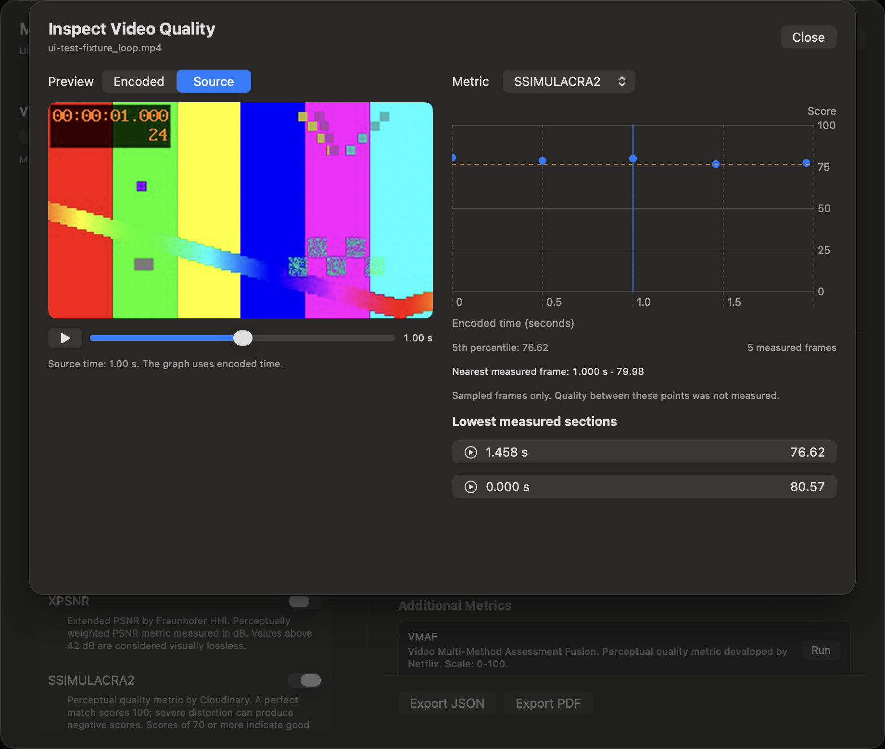

# Aagedal Media Converter

[English](../../README.md) · [Norsk bokmål](README.nb.md) · [Español](README.es.md) · [简体中文](README.zh-CN.md) · [Français](README.fr.md) · [Italiano](README.it.md) · [Deutsch](README.de.md) · [日本語](README.ja.md) · [Português (Brasil)](README.pt-BR.md) · [한국어](README.ko.md)


这是一款轻量、简洁的 macOS 应用，界面简单，却内置了丰富而强大的功能。底层使用 FFmpeg、MPV、SwiftMediaMetadata、yt-dlp、rclone 和 whisper.cpp，完全采用 Swift / SwiftUI 编写。

完全免费、开源。注重隐私，所有处理均在本地进行。可选的更新检查默认开启，也可以关闭。

这是一个出于热爱的个人项目。我为了提高自己的工作效率而开发了它，也想分享给其他人。请注意，应用的大部分代码采用了 AI 辅助的「vibe coding」方式开发。

---

## 安装

### Homebrew
```bash
brew tap aagedal/tap && brew install --cask aagedal-media-converter
```

### 手动下载
[下载当前版本](https://github.com/aagedal/Aagedal-Media-Converter/releases/latest)

---

## 主要功能

- **启动迅速，易于使用**
- **批量转换**几乎所有视频和音频文件（可替代 Shutter Encoder 或 Handbrake）
- **全屏播放**，支持时间码显示和 JKL 播放控制（可替代 IINA 或 VLC）
- **查看和比较元数据**，包括检测是否存在 C2PA 信息（可替代 MediaInfo）
- **分析**响度、静音、峰值、立体声相位和编码视频质量
- **下载**网站视频，支持定时下载和直播下载
- **屏幕录制**，包含系统音频，可选独立麦克风音轨（可替代 OBS）
- **转录**视频和音频，生成 SRT 字幕
- 转换后**上传**至服务器
- 在支持序列预览和波纹修剪的时间线上**拼接**片段
- 通过可选启用的代理访问，使用**本地 MCP 自动化转换**

### 通用功能

- 预览和编码几乎所有视频文件
- 导入和导出**图像序列**（PNG、TIFF、EXR、DPX、JPEG 2000 等），支持关联音频和设置帧率
- 导出包含 JPEG 2000 XYZ 图像和 PCM 音频的 **DCP（数字电影包）**
- 导出实验性的 **IMF App 2e 和 RDD 45** 包，在交付工具中进行验证
- 批量转换、监视文件夹和进度条
- 修剪时长、裁剪画面、重新分配或删除音轨，以及合并格式相同的片段
- 查看和比较元数据
- 丰富的[键盘快捷键](../../KeyboardShortcuts.md)，大部分功能无需鼠标即可操作
- 多种自定义设置
- 自动检查更新并显示低干扰通知，可关闭
- 下载 YouTube、TikTok 等网站的视频（yt-dlp）
- 转录为 SRT 字幕（whisper.cpp）
- 上传至 FTP（rclone）
- 检查 C2PA 签名（SwiftMediaMetadata）
- HDR 屏幕录制，支持系统音频和可选的独立麦克风音轨

### 批量转换

- 自动编码队列中的所有文件
- 拖放文件以调整编码顺序
- 编码过程中可从队列中移除文件

### 监视文件夹

- 自动导入指定文件夹中的文件
- 可与手动拖放导入同时使用，所有编码任务集中在同一窗口
- 可选择自动删除或忽略监视文件夹中的文件
- 点击主窗口工具栏中的眼睛图标启用

### 文件预览

- 支持 JKL 和方向键等常用剪辑快捷键
- 简单的音频电平表（⌘A）
- 对兼容文件使用 macOS 原生播放器，即使倒放也能流畅播放
- 对 macOS 不支持的文件自动使用 MPVKit 播放器，但倒放的可靠性较低

### 快速调整

- 使用拖动手柄或 I/O 快捷键修剪时长
- 从源文件复制时间码、手动设置或移除时间码
- 使用画面上的控件裁剪视频，在修剪视图中按 C 或点击裁剪图标即可进入
    - 不适用于 Stream Copy 预设
- 删除或重排音轨
    - 不适用于 Stream Copy 预设

### 调整

右键点击队列中的文件并选择 **Adjustments…**，可按文件单独设置：

- **旋转** 90°/180° 以及水平或垂直**翻转**（在画面裁剪之后、预设缩放之前应用）
- **变速** 0.25× 至 4×，音频保持原音高
- **淡入淡出**：视频从黑场淡入／淡出至黑场，音频淡入和淡出
- **音频偏移**：修正音画不同步（正值表示延迟音频）
- **替换或添加音频**：从另一个文件导入音频，与修剪范围对齐并适配视频长度
- **烧录字幕**：支持文本字幕轨道或 SRT、ASS、VTT 文件，可设置字号、描边或背景框及位置。图形字幕（PGS、DVD）需先通过字幕 OCR 转为 SRT。
- 针对单个文件覆盖响度归一化设置

调整功能需要重新编码预设，不适用于 Stream Copy、DCP、IMF、AV2、合并任务或生成的波形动画视频。

### 响度归一化

在 **Settings → Presets** 中开启 **Normalize Loudness**，可将每条重新编码的音轨归一化至 EBU R128（−23 LUFS、−1 dBTP）、ATSC A/85、流媒体（−14 LUFS）、网页／播客（−16 LUFS）或自定义目标。每条音轨会先进行第一遍测量，再通过 FFmpeg 的 `loudnorm` 在节目动态允许的范围内以线性增益进行归一化。对于 AVC-Intra 等单声道广播预设，会在拆分前按源音轨分别测量，从而保持立体声平衡。

### 合并队列文件

- 合并编码格式、分辨率、帧率、位深和音轨相同的文件
- 队列中的第一个片段决定时间码和画面裁剪设置
- 在拼接时间线中编辑分组，支持胶片条缩略图、序列播放、波纹修剪、重排、分割、范围删除和撤销。
- 使用 Stream Copy 修剪并合并，无需重新编码。切点取决于源文件的关键帧，可能与选定边界不同；部分元数据可能丢失。
- 导出 Resolve EDL 片段标记和内嵌章节，已有章节可选择保留或替换。

### 从相机存储卡导入

- 导入前按存储卡文件夹和录制日期查看片段。
- 明确标记连续录制的后续片段，也可在间隔超过两小时后拆分分组。兼容性检查有助于识别可拼接的片段。

### 本地代理访问

启用 **Settings → Agent Access**，授权源文件夹，并复制 MCP 客户端的配置。随附辅助程序允许代理浏览和检查已授权的媒体、规划转换、提交任务、跟踪进度，以及取消应用队列中的任务。可使用 21 个内置预设（除 Lossless FFV1 之外的全部内置预设）；自定义 FFmpeg 槽位除外。IMF 导出属于实验性功能。

已接受的任务在客户端断开连接后仍会继续。计划有效期为 15 分钟，已结束任务的结果保留 30 天。代理导出会禁用输出时间码。文件夹授权、客户端配置和任务恢复详见[配置与工作流程指南](../../Documentation/LOCAL_AGENT_ACCESS.md)。

### 生成音频波形动画

- 为纯音频文件生成波形动画
- 7 种原生 Swift 样式（包括 Halo、Orb、Ridgeline 和 LED Meter）以及 5 种经典 FFmpeg 样式，支持渐变调色板、颜色、不透明度、透明背景和归一化选项

### 按源分辨率和位深捕获静态图像

修剪播放器中的相机按钮可按源分辨率捕获静态图像，默认格式为 JPEG XL。可在设置中为不同位深选择图像格式，也可指定如何处理带有 Alpha 通道的视频。

### 导出和文件命名

- 默认移除空格和特殊字符，将 æ、ø、å 替换为 ae、o、aa
- 预览处理后的文件名
- 文件已存在时显示警告
- 编码完成后，点击图标可在导出目录中显示转换后的文件
- 另一个图标支持将输出文件拖至其他应用或目录
- 在设置中选择默认预设
- 设置默认导出位置

### 元数据

- 每个文件都有可选的注释字段，可用于写入署名等信息
- 可在注释前添加日期标签（Generated [YYYYMMDD]）、前缀和后缀
- 查看和比较元数据

### 媒体分析


点击队列中文件的图表按钮，即可查看其音频和视频报告。

- 测量单条音轨、自定义单声道对或 5.1 单声道组的整体节目响度和真峰值；支持导出完整的 JSON 或 PDF 报告。
- 查找静音和峰值区间、比较声道平衡，或检查立体声相关性及单声道缩混效果。可在暂停的预览中跳转到对应测量区间，并导出完整的 JSON 测量数据。
- 检测源视频中的黑场区间（FFmpeg `blackdetect`，可调最小时长、画面比例和像素阈值）和场景切换（FFmpeg `scdet`，可调阈值并为每个切点生成缩略图）。点击事件即可在暂停的预览中检查，并可导出 JSON 或 Resolve EDL 标记。详见[黑场](../../docs/video-black-report-format.md)和[场景切换](../../docs/video-scene-cut-report-format.md)报告格式。
- 编码完成后，可使用 VMAF、PSNR、XPSNR 或采样 SSIMULACRA2 对比视频。支持查看质量随时间的变化、切换源视频／输出视频播放，以及跳转至得分最低的片段。
- SSIMULACRA2 会在所选上限内比较经过验证的解码帧，短片同样适用。视频会先建立索引；采样数越多，耗时越长。
- 将视频质量结果导出为全分辨率 JSON 或分页 A4 PDF，包含时间线、各分量得分和对比警告。详见[分数解读与报告详情](../../docs/video-quality-report-format.md)。

### VideoLoop 预设的 15 秒自动播放提醒

浏览器经常阻止较长的有声循环视频自动播放。当 VideoLoop 预设应用于超过 15 秒的片段时，应用会显示黄色 ⚠️ 图标，提醒你缩短片段或选择其他预设。

### App Intents

1. 添加至编码队列。
2. 使用默认预设立即转换视频。

---

## 导出预设

所有预设均可设为启动时的默认预设。除默认预设外，其他预设都可以从选择器中隐藏。

#### Video Loop

针对无声、无缝循环视频优化。采用 x264、CRF 23（约 3–9 Mbps 可变码率）编码，移除音频，并将短边限制为 1080 像素，便于网页播放。片段超过 15 秒时会显示时长提醒。

#### Video Loop w/ Audio

与无声版本使用相同的 x264 设置，但保留所有音轨并编码为 128 kbps AAC，短边仍限制为 1080 像素。

#### H.264 / AVC

兼容性广泛的 H.264/AVC 编码。可选择快速的 VideoToolbox 硬件编码，或注重质量、支持 CRF 控制的 libx264 软件编码。支持 MP4、MOV 和 MKV 容器。

#### H.265 / HEVC

现代的 10 位 H.265/HEVC 编码。VideoToolbox 硬件编码可加快导出，也可选择 libx265 软件编码以提高压缩效率。

#### AV1

使用 SVT-AV1 编码，支持 10 位和高压缩效率。仅支持软件编码，在 macOS 上无硬件加速。

#### AV2（实验性）

使用随附的 AOM AVM 参考编码器（`avmenc`）进行实验性 AV2 编码，该功能最初在预览版本中推出。支持 8/10 位输出、恒定质量或可变码率模式，以及可配置的速度和分辨率。在恒定质量模式下，可分段并行编码以利用多个 CPU 核心。

随附的编码器和解码器基于 AVM `1.0.0-445-g14342caad`（2026 年 10 月 14 日）。相关工具仍处于实验阶段；固定的源码版本、重新构建说明与检查记录详见[构建与兼容性验证](../../docs/av2-integrated-encoder-2026-10-14.md)。

可选择纯视频 IVF（`.ivf`）或带有 AAC / Opus 音频的 Matroska（`.mkv`）。参考编码非常慢，播放需要支持 AV2 的解码器。应用可以解码 AV2 文件进行转换和生成缩略图，但尚不支持交互式播放。AV2 适合实验，不适合作为交付格式。

#### VP9 / WebM

面向网页的免版税 VP9 编码，使用 libvpx 以恒定质量模式（目标码率为 0 的 CRF）和基于行的多线程进行编码。可选择 CRF、从 Best 到 Realtime 的速度、8 位（profile 0）或 10 位（profile 2），以及分辨率上限。音频采用可选码率的 Opus 编码。输出为 WebM 或 Matroska（`.mkv`）。Opus 无法编码某些声道布局（如 `5.1(side)`），请使用音频路由将此类音轨下混。

#### TV (HEVC 10-bit 4:2:2)

广播交付格式，采用硬件 HEVC 10 位 4:2:2 编码，支持设置分辨率和帧率、自动调整码率，并将所有音频通道保留为 24 位 PCM。

#### TV (AVC-Intra)

采用 MXF 容器的广播交付格式。AVC-Intra 10 位 4:2:2 支持选择 50/100/200 Mbps 等级、分辨率和帧率，并提供 4/8/16 个 24 位 PCM 单声道音频通道。

#### XDCAM HD422 (MXF)

Sony XDCAM HD422 广播交付格式：在 MXF OP1a 文件中采用 MPEG-2 4:2:2 Profile @ High Level、50 Mbps CBR 长 GOP（25/50 Hz 为 12 帧封闭 GOP，29.97/59.94 Hz 为 15 帧封闭 GOP，含两个 B 帧）。可选 1080i50、1080p25、1080i59.94、1080p29.97、720p50 或 720p59.94。源画面会缩放并按需加左右黑边或上下黑边以匹配全栅格 16:9，音频交付为 4 或 8 条单声道 24 位 48 kHz PCM 音轨。

#### Stream copy

将现有音视频流复制到新文件，保留原始编码、元数据和扩展名，适合修剪和合并任务。

#### ProRes

采用 Apple ProRes（yuv422p10）生成便于剪辑的母版。包含第一个视频流和音频流，保留 24 位 PCM 音频，并使用标准 ProRes 码率。可在预设设置中选择默认 ProRes 配置。

#### DNxHR

按源分辨率输出用于剪辑和母版制作的 Avid DNxHR：LB、SQ 或 HQ（8 位 4:2:2）、HQX（10 位 4:2:2）或 444（10 位 4:4:4）。可选择 MOV 或 MXF 容器。每条音轨均保留为 24 位 PCM（在 MXF 中重采样至 48 kHz）。

#### CineForm

按源分辨率输出至 MOV 容器的 GoPro CineForm，适用于剪辑与精编：10 位 4:2:2 YUV、12 位 4:4:4 RGB 或带 Alpha 通道的 12 位 4:4:4 RGB。质量可在 Low 至 Film Scan 3+ 之间选择（默认 Film Scan 1）。该编码每通道最多存储 12 位，因此 16 位源文件会降至 12 位。FFmpeg 编码器要求宽度为 16 的倍数，其他宽度会在左右两侧补黑边。每条音轨均保留为 24 位 PCM。

#### Proxy

生成轻量的 HEVC、ProRes Proxy 或 DNxHR 代理文件，支持设置分辨率上限。所有音频通道均保留为未压缩 PCM，适合离线剪辑，并可使用源素材旁的独立 Proxy 子文件夹。

#### DCP (Digital Cinema Package)

导出符合 SMPTE 标准的数字电影包。将 BT.709 输入转换为 12 位 XYZ 色彩空间并编码为 JPEG 2000，使用 asdcp-wrap 封装为 MXF，并生成所需的 SMPTE XML 文件（CPL、PKL、ASSETMAP、VOLINDEX）。支持 2K 和 4K 的 Flat、Scope、Full 规格，帧率为 24/25/30/48 fps，码率可设为 100–250 Mbps。音频以 24 位 PCM 导出至独立 MXF 轨道。每项素材的元数据可编辑内容标题、类型、注释、分级和音频语言。缩放模式包括适应画面（加黑边）和填满画面（裁剪）。

#### IMF App 2e / RDD 45（实验性）

实验性的 IMF 包导出，包含一个图像轨道和一个 PCM 音频轨道。不支持包内字幕或多个音频轨道。用于交付之前，请在目标母版制作或交付工具中验证每个包。

#### Image Sequence

导入和导出 PNG、JPEG、TIFF、EXR、DPX、BMP、TGA、SGI、JPEG XL 和 JPEG 2000 图像序列。导入时自动检测帧编号，并允许编号缺失。可关联音频文件用于播放和导出。帧率可按序列设置，也可根据关联音频的时长自动计算。导出时可生成独立的元数据文件（Markdown 或 JSON），记录色彩空间、编码和相机信息。

#### Animated Stills

生成 GIF、AVIF、动画 PNG（APNG）、动画 WebP 或动画 JPEG XL 动图序列，可在预设设置菜单中选择。

#### Lossless (FFV1)

使用 Matroska（`.mkv`）容器和未压缩 PCM 音频的数学无损 FFV1 归档编码。

#### Audio Only

将音频提取或转码为 WAV（保留所有声道的未压缩 PCM）、FLAC、ALAC 或 AAC/MP4，可在预设设置中配置。

#### 10 个自定义 FFmpeg 预设

十个自定义预设（C1–C10）允许设置输出参数、文件名后缀和扩展名。输入参数由应用自动处理。使用 `-copy` 的路径不能与预设设置中的画面裁剪或音频重分配选项组合使用。

#### [待办事项 / 已知问题](../../TODO.md)

---

## 截图

#### 分组时间线视图

在片段列表旁预览序列，显示缩略图、音频波形、修剪手柄和输出时间码。时间线还提供分割、标记、范围选择和缩放控件。


#### 时长修剪视图


#### 画面裁剪视图


#### 音频重分配


#### 下载视图


#### 元数据视图


#### 时间码覆盖视图


#### 设置视图


#### 全屏播放器


---

## 系统要求

| | 最低要求 |
|---|---|
| macOS | 15.0（Sequoia）或更高版本 |
| 硬件 | Apple Silicon（M1 或更新型号） |

---

## 使用方法

应用界面支持英语、挪威语书面语、德语、西班牙语、法语、意大利语、日语、韩语、巴西葡萄牙语和简体中文，并遵循 macOS 系统设置中的首选应用语言。新增的八种语言翻译为初版，待语言校对的字符串在 `Aagedal Media Converter/Resources/Localizable.xcstrings` 中标记为 **Needs Review**。

1. 启动应用。
2. 将视频文件拖入窗口，或点击加号按钮导入文件。
3. 从工具栏菜单选择**导出预设**。
4. 点击绿色的 *Convert* 按钮，或按 ⌘⏎。

这是一个在业余时间开发的个人项目，我不会因此获得报酬。

---

## 许可证

本项目采用 **GNU General Public License，版本 3.0** 发布。完整文本见 [LICENSE](../../LICENSE)。

随附的 FFmpeg 二进制文件使用 `--enable-gpl` 编译，因此采用 **GPL v2 或更高版本**。本项目的全部代码采用 GPL v3，满足该要求。请参阅 [FFmpeg 原始许可证](../../Licenses/ffmpeg-LICENSE.txt)。

随附的 asdcp-wrap 二进制文件来自 John Hurst 的 [asdcplib](https://github.com/cinecert/asdcplib)，采用 **BSD 3-Clause License**。请参阅 [asdcplib 许可证](../../Licenses/asdcplib-LICENSE.txt)。

---

## 致谢

DCP 导出功能的色彩处理参考了 [DCP-o-matic](https://dcpomatic.com/) 项目关于 DCI XYZ 色彩空间转换的优秀文档。DCP-o-matic 是免费、开源的 DCP 制作工具：[GitHub 项目](https://github.com/cth103/dcpomatic)。

元数据检查和 C2PA 内容真实性功能由 [SwiftMediaMetadata](https://github.com/aagedal/SwiftMediaMetadata) 提供支持。

---

附注：此应用曾名为 Aagedal VideoLoop Converter。Aagedal Media Converter 是同一款应用，只是新名称更能体现它现在的功能。
