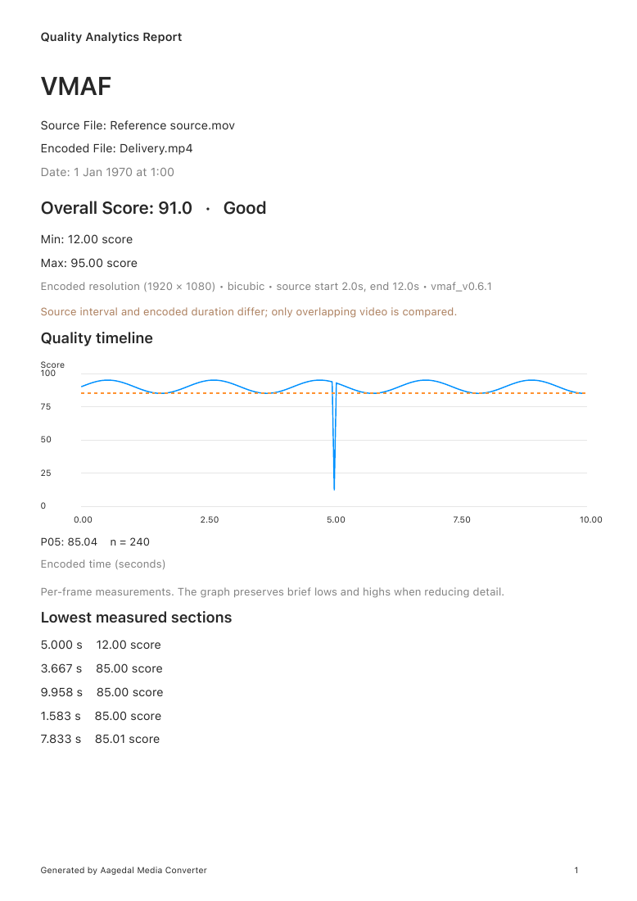

# Video quality reports and score interpretation

Media Analysis → Video compares a source with its completed encoded output.
The report retains the conversion's source interval independently of subsequent
queue trim edits. Comparison metadata records resolution, scaling, timing,
VMAF model and any known alignment limitations. Differing frame rates or durations
can repeat/drop frames or restrict comparison to overlapping video; the report
retains those warnings. SSIMULACRA2 measures selected frames rather than every
frame, and quality between sample points is unknown.

## PSNR and XPSNR

PSNR uses FFmpeg's pooled mean-squared-error overall score. Parsed component
labels follow the actual filter output: grayscale Y, Y/U/V, RGB, and optional A.
An alpha change contributes to PSNR when alpha is present in the negotiated
comparison format. Components absent from the filter output are not invented.

XPSNR reports the minimum of FFmpeg's whole-program color-component averages,
as recommended in [FFmpeg's filter documentation](https://ffmpeg.org/ffmpeg-filters.html#xpsnr).
Those averages are calculated by FFmpeg, not by averaging the per-frame dB
readings in the graph. Each XPSNR timeline sample similarly takes that frame's
lowest measured color-component score. This prevents a matching chroma component
with infinite score from hiding a finite luma error. FFmpeg XPSNR excludes alpha;
comparison metadata states that limitation. Use alpha-aware PSNR when alpha
fidelity matters, and check the reported component list.

Positive infinity denotes an exact match for the components measured by that
metric. NaN and negative infinity are rejected by the PSNR/XPSNR parser. Signed
and exponent-form finite numbers are accepted. Grayscale and RGB XPSNR reports
retain their native component names. Partial, duplicate or malformed component
sets fail instead of silently discarding a damaged component.

JSON metrics now include an optional `scoreAggregation` field:

- PSNR: `pooled_mse_all_components`.
- XPSNR: `minimum_channel_average`.

Historical JSON without this field remains decodable. Historical XPSNR results
used a luma-weighted arithmetic average of component dB scores and may incorrectly
show infinity when any component matched. Rerun XPSNR to obtain the corrected
score and timeline; exporting an existing report does not recalculate it.
For new XPSNR reports, `min` is omitted because FFmpeg's summary minimum is across
component averages, not across frames. Temporal lows remain available in the
quality timeline and its lowest-scoring sections.

## PDF and JSON

JSON retains every measured timestamp/score and comparison metadata, including
positive infinity encoded as `"Infinity"`. It is independent of chart reduction.

PDF uses A4 pages, starts each metric on a new page, and carries long metadata and
warnings onto additional pages. Each metric includes file identity, measurement
time, overall/component scores, comparison method and warnings, and its quality
timeline. The chart preserves each decimation bucket's extremes. SSIMULACRA2
uses points and an explicit sampling notice. Infinity is drawn at the chart
ceiling and identified as such. `P05` is the nearest-rank fifth percentile of
measured scores, including infinity; `n` counts measured frames. The five lowest
finite sections are at least one second apart, matching the interactive inspector.
Old reports without samples show an explicit request to rerun the metric.

Charts are vector paths and text remains selectable. Headers, page numbers and
footers are repeated; long text is paginated using actual visible character
ranges. Native JSON and PDF saves hold security-scoped destination access and
write atomically. Cancelling the save panel preserves the measurement.

## SSIMULACRA2 frame sampling

The frame limit applies to distinct decoded frame ordinals, including on short
clips. The first and last eligible frames are included when the limit is at
least two; intermediate ordinals are evenly spaced. Both videos are decoded to
build disk-backed timestamp indexes before sparse PNG extraction. This adds an
upfront decode pass and keeps retained index memory and image disk usage bounded.

PNG filenames carry their actual nanosecond presentation timestamps. A seeked
image is accepted only when its timestamp matches the indexed frame. Duplicate
timestamps and failed/missing seek outputs use ordinal decoding from the start.
Nonmonotonic timestamps are rejected rather than producing ambiguous scores.
Source trim starts are observed with FFmpeg's actual input seeking, preserving
native timebase rounding. A trim that cannot be decoded/verified fails explicitly.

References use sample-and-hold matching, with only the measured output
timebase rounding uncertainty absorbed at frame boundaries. Duplicate timestamps
match their occurrence within the timestamp group, bounded by available reference
frames. Overlap ends at the decoded video boundary, including the final frame's
reported duration; audio-only tails cannot extend a reference. Unknown terminal
frame duration is conservatively excluded.

JSON comparison metadata retains `sampleTimestamps`, `samplingPolicy`,
`sourceVideoStart`, `encodedVideoStart` and `comparedDuration`. Each sampled
`QualitySample.framePair` records source/encoded decoded ordinals and file-relative
presentation times. Sample `seconds` and graph positions are relative to the first
encoded video frame. Inspection uses the measured source and encoded video origins.
Older reports retain the legacy trim-based playback origin when fields are absent.
PDF metadata includes the measured origins, compared duration and matching policy.
SSIMULACRA2 helper scores must be finite; perfect matches score 100.

## Validation

The decoded sampling continuation passes the final Debug build and full 1,440-test
unit suite with zero failures and one intentional benchmark skip
(`/private/tmp/amc-sampling-reviewed-unit.xcresult`). Generated sampling checks
cover fractional CFR, VFR reference holds, duplicate timestamps, delayed starts,
trim rounding and exclusive ends, trailing audio, real unseekable raw H.264,
successful empty seeks, malformed/nonfinite scores and cancellation drainage.

The final Debug build and 1,431 unit tests pass with zero failures and one
intentional benchmark skip (`/private/tmp/amc-quality-final-unit.xcresult`). Generated examples cover grayscale, RGB, alpha-only
changes and luma distortion with infinite matching chroma scores. PDF tests
verify A4 page geometry, timeline content, infinity handling, complete long-text
pagination and historical reports without samples. Eight final rendered pages
were visually inspected, including all four metrics and a four-page overflow
case. The sample below is generated by the native renderer from deterministic
test measurements.

Both final English/Norwegian UI save checks pass in
`/private/tmp/amc-quality-verified-ui.xcresult`, verifying save cancellation,
two metric pages, localized timeline labels and report preservation after saving.
The source/output inspector check passes separately in
`/private/tmp/amc-quality-report-ui.xcresult`.

